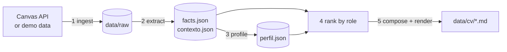

# ScrapCV — Technical Documentation

Developer-facing reference for how ScrapCV works internally. For the user-facing overview and the requirements
traceability table (CAR-xx), see [`README.md`](README.md).

> Code comments, UI strings, JSON keys and on-disk file names are in **Spanish** (`perfil.json`, `contexto.json`,
> `dudoso`, `materia`…). This document is in English but keeps those identifiers verbatim.

## Contents

1. [What it does](#1-what-it-does)
2. [Quick start for developers](#2-quick-start-for-developers)
3. [Architecture](#3-architecture)
4. [The pipeline, stage by stage](#4-the-pipeline-stage-by-stage)
5. [Data model](#5-data-model)
6. [On-disk layout](#6-on-disk-layout)
7. [Extraction subsystem](#7-extraction-subsystem)
8. [Profiling and truthfulness guards](#8-profiling-and-truthfulness-guards)
9. [Ranking](#9-ranking)
10. [CV composition and rendering](#10-cv-composition-and-rendering)
11. [Canvas integration](#11-canvas-integration)
12. [Configuration and secrets](#12-configuration-and-secrets)
13. [UI and threading model](#13-ui-and-threading-model)
14. [Security model](#14-security-model)
15. [Extending ScrapCV](#15-extending-scrapcv)
16. [Testing](#16-testing)
17. [Gotchas and known limits](#17-gotchas-and-known-limits)

---

## 1. What it does

ScrapCV turns a student's **own** Canvas submissions into a CV draft in which every line is backed by evidence.



Design rules that shape the whole codebase:

- **Numbers never come from the LLM.** Every figure in the CV comes from static analysis (`Facts`) or the Canvas grade.
- **Everything runs locally.** The only network calls are to the Canvas API and to a *loopback* Ollama server.
- **Failures are isolated.** A bad file, submission or course is flagged in `index.json` and the run continues.
- **Every stage is resumable.** Each stage reads the previous stage's output from disk, so any stage can be re-run alone.
- **Every CV bullet is traceable** to a path under `data/raw/…`.

Stack: Python ≥ 3.11, Tkinter (stdlib), `requests`, `pypdf`, `python-docx`, `python-pptx`. Optional: Ollama (local LLM),
`7z` on `PATH` (for `.rar`/`.7z`).

## 2. Quick start for developers

```bash
python -m venv .venv
.venv\Scripts\activate                 # macOS/Linux: source .venv/bin/activate
pip install -r requirements-dev.txt    # includes requirements.txt + pytest
python main.py                         # launches the Tkinter app
python -m pytest                       # runs the test suite
```

The app starts in **demo mode** (`Settings.use_demo = True`): no token needed, and `DemoCanvasGateway` generates five
fake courses of submissions in memory. This is also what the test suite uses.

Headless usage (what the tests do):

```python
from scrapcv.bootstrap import build_app
from scrapcv.infrastructure.config import Settings

app = build_app(Settings(data_dir="/tmp/data", use_demo=True, use_llm=False), token=None)
app.run_all()                                   # ingest → extract → profile
role = app.roles.get("Prácticas de desarrollo backend")
from scrapcv.ranking.ranker import SelectionCriteria
result = app.generate_cv(role, SelectionCriteria(max_projects=3))
print(result.markdown, result.path)
```

## 3. Architecture

Layered, with dependencies pointing inward toward `domain/` and `ports.py`.

```
ui/ (Tkinter) ──► application/facade.py ──► application/* services ──► ports.py (ABCs)
                                                                          ▲
bootstrap.py (composition root) ── wires concrete classes from ──► infrastructure/ · extraction/ ·
                                                                    analysis/ · ranking/ · writing/
```

| Package | Responsibility | Depends on |
|---|---|---|
| `domain/` | Pure dataclasses (`Submission`, `IndexEntry`, `Facts`, `ProjectProfile`) and text helpers. No I/O. | nothing |
| `ports.py` | Small abstract interfaces (`CanvasReader`, `IndexRepository`, `LanguageModel`, `ProjectProfiler`…). | `domain` |
| `application/` | Use cases: `IngestService`, `ExtractionService`, `ProfileService`, `CvService`, `CvReviser`, and `ScrapCvFacade`. | `ports`, `domain`, plus concrete `extraction`/`ranking`/`writing` types it is handed |
| `infrastructure/` | Adapters: Canvas HTTP + gateway, demo gateway, JSON storage, Ollama, config, logging. | `ports`, `domain` |
| `extraction/` | Static analyzer and one `FormatExtractor` per file format. | `domain` |
| `analysis/` | Bounded LLM context, profilers, truthfulness guards. | `ports`, `domain` |
| `ranking/` | Job roles, scorers, filters. | `domain` |
| `writing/` | CV composition (`CvComposer`) and Markdown rendering. | `domain`, `ranking` |
| `ui/` | Window, tabs, controller, background runner. | `application.facade` only |
| `bootstrap.py` | **Composition root.** The only place that instantiates concrete classes. | everything |

Key entry points:

- `main.py` → builds `AppController(SettingsStore(), build_app, list_ollama_models)` and the `MainWindow`.
- `bootstrap.build_app(settings, token) -> ScrapCvFacade` — wires the graph. Called again whenever settings change.
- `ScrapCvFacade` — the **only** object the UI talks to.

### Patterns in use

Adapter (Canvas, Ollama) · Strategy (profilers, scorers, renderers) · Registry (extractors) · Template Method
(`_ArchiveExtractor`) · Chain of guards (`ProfileValidator`) · Observer (`ProgressListener` → `QueueProgress` → window) ·
Facade (`ScrapCvFacade`) · Composition Root (`bootstrap.py`). Composition is preferred over inheritance.

## 4. The pipeline, stage by stage

`ScrapCvFacade.run_all()` runs stages 1–3. Stages 4–5 are triggered from the CV tab.

| # | Service | Reads | Writes | Gate (which entries it processes) |
|---|---|---|---|---|
| 1 | `IngestService` | Canvas | `data/raw/<key>/*`, `index.json`, `usuario.json` | every submission with evidence (attachments, inline body, or URL) |
| 2 | `ExtractionService` | `data/raw/<key>/` | `data/analysis/<key>/facts.json`, `contexto.json`, `unpacked/` | entries whose **ingest** status is `ok` or `parcial` |
| 3 | `ProfileService` | `facts.json`, `contexto.json` | `perfil.json` | entries whose **extract** status is `ok` or `parcial` |
| 4 | `CvService.ranking` | index + facts + profiles | – | entries whose **extract** status is `ok`/`parcial` (profile optional) |
| 5 | `CvService.generate` | ranked projects | `data/cv/cv_<role>.md` | – |

### Stage 1 — ingest (`application/ingest.py`)

1. `reader.current_user()` — also validates the token; saves `usuario.json` (name/email for the CV header).
2. `reader.list_courses()` — active **and** completed.
3. Per course: `list_submissions()` filtered by `Submission.has_evidence`. A failing course increments `errors` and is skipped.
4. Per submission (`_ingest_one`):
   - Writes `submission.json` (metadata, grade, teacher comments; **signed attachment URLs are not stored**).
   - Writes `texto_en_linea.html` if there is an inline body, `enlaces.json` if there is a URL.
   - Downloads each attachment to `raw/<key>/<safe_filename>`. Name collisions are prefixed with the attachment id.
   - **Resume logic:** an existing file is reused if its size matches (or Canvas reports size 0).
   - Sets the ingest stage: `ok` (no failures) / `parcial` (some failures but other evidence exists) / `error` (nothing usable).
   - A previous `IndexEntry.stages` is carried over, so re-ingesting does not erase extraction/profile status.
5. `index.save()` after **each course** (incremental), plus a final save.

### Stage 2 — extraction (`application/analysis.py::ExtractionService`)

Calls `StaticAnalyzer.analyze(key, raw_dir, work_dir)` per entry (see [§7](#7-extraction-subsystem)), persists `Facts` and
snippets, then derives the status:

- `marcado` (flagged) if `not facts.has_readable_content` (no code lines and ≤ 40 chars of document text). Reasons default to
  `"sin contenido legible"`.
- otherwise `parcial` if any `Flag` exists, else `ok`.
- unexpected exception → `error`, logged with traceback, run continues.

The `reasons` list in the index combines each flag (`path: reason`) and a note about skipped credential files.

### Stage 3 — profiles (`ProfileService`)

One entry at a time (sequential on purpose, to be gentle on a local model). Status is `parcial` when
`profile.doubtful` is non-empty, else `ok`. A missing `facts.json` is an `error`. The index is saved after every entry.

### Stages 4–5 — rank and write (`application/cv_service.py`)

`CvService.generate(role, criteria)`: `ranking()` → `CvComposer.compose()` → `CvRenderer.render()` → `save_draft()`.
`save_edit()` overwrites the draft; `approve()` writes `cv_<role>_final.md` — **a "final" CV only exists after explicit approval.**

### Optional — CV revision (`application/cv_revision.py`)

`CvReviser.revise(markdown, instruction)` asks the local model to apply a free-text instruction. The result is **rejected**
(`RevisionRejected`) if the model returns invalid JSON/empty markdown, or if it introduces any number that was not already
in the original CV or in the instruction. Only wired up when `use_llm` is on and an Ollama model is selected.

## 5. Data model

Defined in `domain/models.py` and `domain/facts.py`.

```
Course ──< Submission >── Attachment, Comment
              │ key = "<course.slug>/<assignment-slug>_<assignment_id>"
              ▼
          IndexEntry ── stages{ "ingesta" | "extraccion" | "perfil" } → StageResult(status, reasons[])
              │
              ├── Facts           (facts.json)    — measured, deterministic
              ├── TextSnippet[]   (contexto.json) — text fragments for the LLM context only
              └── ProjectProfile  (perfil.json)   — summary/technologies/skills/role/doubtful
```

- **`Submission.key`** is the stable identifier used everywhere: it is both the index key and the relative folder path under
  `raw/` and `analysis/`. `Course.slug` = `slugify(code or name)_<id>`; `Submission.slug` = `slugify(name)_<assignment_id>`.
- **`StageStatus`**: `pendiente`, `ok`, `parcial` (processed but something flagged), `marcado` (no readable content),
  `error`. Stage names: `ingesta`, `extraccion`, `perfil`.
- **`Facts`** holds: per-language `{files, lines}`, `dependencies`, `documents` (`DocumentStat(path, kind, chars, units)`),
  `links`, `flags`, counters (`images`, `files_seen`, `credentials_skipped`), booleans (`has_readme`, `has_git_history`),
  and path lists (`evidence_files`, `code_files`, `dependency_files`) used later for traceability.
- **`ProjectProfile.doubtful`** (`dudoso` in the LLM JSON) is the list of things the user must verify. It is rendered in the CV
  as `⚠ Verificar:`.
- `IndexEntry.grade_ratio` = `score / points_possible`, clamped to `[0, 1]`, or `None`.

## 6. On-disk layout

Root is `Settings.data_dir` (default `./data`, git-ignored).

```
data/
├── index.json                         {"version": 1, "entries": [IndexEntry…]}   (atomic writes)
├── usuario.json                       {id, name, email}
├── raw/<course>_<id>/<task>_<id>/     downloaded evidence
│   ├── submission.json                metadata + grade + teacher comments + attachment names/sizes
│   ├── texto_en_linea.html            inline text submission (if any)
│   ├── enlaces.json                   URL submission (if any)
│   └── <attachments…>                 *.part while downloading, renamed atomically on completion
├── analysis/<course>_<id>/<task>_<id>/
│   ├── facts.json
│   ├── contexto.json                  [{source, text, priority}]
│   ├── perfil.json
│   └── unpacked/<label>/              extracted archives ("!/" and "/" in the label become "__")
├── cv/
│   ├── cv_<role-slug>.md              draft
│   └── cv_<role-slug>_final.md        approved
└── logs/scrapcv.log                   secrets redacted
```

All JSON is written through `_write_json_atomic` (write `*.tmp`, then `os.replace`) so a crash cannot leave a half-written
index. Reads tolerate missing/corrupt files by returning `None`.

`DataLayout` is the single owner of these paths — nobody else builds them by hand. User settings and the optional saved
token live **outside** the data dir, in `~/.scrapcv/config.json`.

## 7. Extraction subsystem

`extraction/analyzer.py::StaticAnalyzer` walks a submission folder and delegates to a registry of `FormatExtractor`s.

### Walk algorithm

```
pending = deque([Context(base=raw_dir, label_prefix="", depth=0)])
while pending:
    ctx = pending.popleft()
    for each file under ctx.base (sorted; skip symlinks; skip ignored folders; skip *.part and submission.json):
        count it in files_seen
        if CredentialPolicy.is_sensitive(file):  credentials_skipped += 1; continue      # never opened
        extractor = registry.find(file)
        if none:               flag "formato no soportado"
        else try extractor.extract(file, ctx) except ExtractionError/OSError → flag(reason)
        collector.add(result)
        for each archive result.unpacked: pending.append(Context(folder, label "x.zip!/", depth+1))
```

Archives are handled breadth-first: extracting a zip returns an `UnpackedArchive`, which is queued as a new context so its
contents go through the same pipeline. The `label` (e.g. `entrega.zip!/src/main.py`) is what ends up as CV evidence.

`FactsCollector` merges all `ExtractionResult`s into one `Facts` (dedupes links by URL, sorts dependencies
case-insensitively, sorts snippets by priority).

### Registry order = priority

`extraction/factory.py::default_registry()` — first match wins, **most specific first**:

| Order | Extractor | Matches | Produces |
|---|---|---|---|
| 1 | `LinksManifestExtractor` | `enlaces.json` | classified links |
| 2 | `ReadmeExtractor` | `readme`/`leeme`/`léame` + (`""`, `.md`, `.txt`, `.rst`) | `readme=True`, doc stat `kind="readme"`, snippet (priority 1, 3000 chars) |
| 3 | `DependencyManifestExtractor` | `requirements.txt`, `package.json`, `pyproject.toml`, `pom.xml`, `build.gradle(.kts)`, `go.mod`, `Cargo.toml`, `composer.json`, `Gemfile`, `*.csproj` | dependency names, snippet (priority 2) |
| 4 | `InlineTextExtractor` | `texto_en_linea.html`, `.txt`, `.md`, `.rst` | doc `kind="texto"`, links |
| 5–7 | `ZipExtractor`, `TarExtractor`, `SevenZipExtractor` | `.zip`; `.tar/.tar.gz/.tgz/.tar.bz2/.tar.xz`; `.rar/.7z` | unpacked archive |
| 8 | `NotebookExtractor` | `.ipynb` | markdown cells → text; code cells → code lines |
| 9–11 | `PdfExtractor`, `DocxExtractor`, `PptxExtractor` | `.pdf`, `.docx`, `.pptx` | doc stat + text snippet (priority 4) + links |
| 12 | `ImageExtractor` | png/jpg/jpeg/gif/bmp/webp/heic/svg | `images += 1` (no OCR) |
| 13 | `SourceCodeExtractor` | ~40 extensions in `LANGUAGES` | per-language lines + snippet |

Because of the ordering, `requirements.txt` is read as a dependency manifest (#3) rather than plain text (#4).

### Per-extractor details

- **Code:** counts **non-blank lines**. Files over 2 MB are flagged and excluded from the count (usually generated). Entry points
  (`main.py`, `app.py`, `index.js`, `Main.java`…) get a 60-line snippet at priority 3; other files 25 lines at priority 7.
- **PDF:** flagged as "escaneado o sin texto" if extracted text is under 25 chars/page (OCR is a phase-4 item).
- **Notebook:** language comes from `metadata.kernelspec.language` (default Python).
- **Links** (`LinkClassifier`): regex-detected `http(s)://` URLs, classified by host into `repositorio` (GitHub/GitLab/Bitbucket),
  `drive`, `figma`, `youtube`, or `otro`. Links are only recorded, never fetched.
- **`.git`** directories set `has_git_history = True` and are otherwise ignored (commit-based contribution is future work).

### Policies (`extraction/policies.py`)

- `CredentialPolicy`: fnmatch patterns such as `.env`, `.env.*`, `*.pem`, `*.key`, `id_rsa*`, `credentials*`, `secrets*`,
  `service-account*.json`, `*token*.json`, `.npmrc`, `.kdbx`… Matching files are **counted and skipped without being opened**.
- `IgnoredFolderPolicy`: `node_modules`, `__pycache__`, `.venv`, `venv`, `env`, `dist`, `build`, `target`, `bin`, `obj`, `.idea`,
  `.vscode`, `.gradle`, `.next`, `.mypy_cache`, `.pytest_cache`, `__MACOSX`, `.git`.

### Safe archive extraction (`extractors/archives.py`)

`_ArchiveExtractor` is a Template Method: shared safety checks live in the base, each format implements `_unpack()`.

| Threat | Defence |
|---|---|
| Zip-slip / absolute paths / `C:` drive paths | `safe_member_path()` resolves the target and rejects anything outside the destination |
| Symlinks / devices in archives | zip: mode-bit check; tar: only `isfile()` members extracted |
| Zip bombs | `ArchiveLimits`: 500 MB total, 10 000 members, compression ratio ≤ 200 |
| Nested archives | `max_depth = 3`; beyond that a flag is emitted |
| `.rar` / `.7z` | needs `7z`/`7za` on `PATH`; otherwise flagged. Member names are validated from `7z l -slt` *before* extraction |

`UnsafeArchive` subclasses `ExtractionError`, so a hostile archive becomes a flag, not a crash.

## 8. Profiling and truthfulness guards

A `ProjectProfiler` turns `Facts` + snippets into a `ProjectProfile`. Three interchangeable implementations
(`analysis/profilers.py`):

| Class | Behaviour |
|---|---|
| `LlmProjectProfiler` | Builds a bounded context, asks the model for JSON, validates through the guard chain |
| `StaticProjectProfiler` | No model. Summary like `Entregó «X» con código en Python y documentación (pdf).`; technologies = languages + first 6 dependencies; always adds a "write this in your own words" doubt |
| `FallbackProjectProfiler(primary, fallback)` | Tries primary; on **any** exception falls back and prepends `"El modelo local no respondió…"` to `doubtful` |

`bootstrap._profiler()` returns the static profiler when `use_llm` is off or no model is chosen, otherwise
`Fallback(Llm(OllamaLanguageModel), Static)`. The UI shows `profiler_name` in the stage banner.

### Bounded context (`analysis/context.py`)

`ContextBuilder(budget_chars=7000, max_per_snippet=2000)` prepends a facts summary (course, task, group flag, languages,
first 25 dependencies, document kinds), then appends snippets in priority order (README 1 → manifests 2 → entry points 3 →
documents 4 → other code 7), **skipping** any snippet that would exceed the budget. The whole project is never sent.
The sources actually used are stored in `profile.sources` and later cited in the CV.

### Prompt contract

The system prompt (Spanish) demands: use only the supplied evidence; **no numbers or metrics**; describe what was *delivered*, not
what the assignment asked; put uncertainty in `dudoso`; past-tense verbs. Expected JSON:

```json
{"resumen": "", "tecnologias": [], "habilidades": [], "alcance": "", "rol": "", "dudoso": []}
```

### Guards (`analysis/guards.py`)

Applied in this order by `ProfileValidator`; `doubtful` is de-duplicated at the end.

1. **`NumberGuard`** — strips numbers (incl. `%`, `k`, `mil`, `por ciento`) from `summary`, `scope`, `role` and `skills`; if anything
   was removed it adds a doubt explaining that CV figures come only from static analysis.
2. **`TechnologyEvidenceGuard`** — keeps only technologies found in the *evidence corpus* (languages + dependencies + snippet
   text, lowercased). Matching ignores spaces/`-`/`_`/`.` and knows a few aliases (`scikit-learn`↔`sklearn`, `react.js`→`react`,
   `node.js`→`node`). Rejected ones become doubts.
3. **`GroupWorkGuard`** — for group assignments prefixes `role` with `"Proyecto en equipo."` and adds a doubt asking the user to
   confirm their own share.

### Local-only model (`infrastructure/ollama.py`)

`OllamaLanguageModel.__init__` resolves the host and raises `RemoteModelRejected` unless it is loopback. Requests go to
`/api/chat` with `stream=false`, `format="json"`, `temperature=0.1`, 600 s timeout. Any transport/JSON problem raises
`LanguageModelError`. `list_models()` (`/api/tags`) powers the model dropdown and returns `[]` on any failure.

## 9. Ranking

`ranking/ranker.py`. A `WeightedRanker` combines `ProjectScorer` strategies (each returns a `ScoreDetail` in `[0, 1]`):

| Scorer (`name`) | Weight | Computation |
|---|---|---|
| `RoleAffinityScorer` (`afinidad`) | 0.6 | matched role keywords ÷ `min(5, len(role.keywords))`, capped at 1. Multi-word keywords match as substrings of the normalized corpus; single words match against the token set |
| `SizeScorer` (`tamaño`) | 0.2 | `log10(1 + units) / log10(1 + 3000)` with `units = code_lines + document_chars / 60` — log scale so volume alone doesn't win |
| `GradeScorer` (`calificación`) | 0.2 | `score / points_possible`; **0.5** (neutral) when ungraded |

Total = weighted average, rounded to 4 decimals; ties broken by `entry.key` for deterministic output.

The candidate **corpus** is assignment name + course name + languages + dependencies + document kinds + (if profiled) summary,
scope, technologies and skills, lowercased and ASCII-folded. One-letter languages (`C`, `R`) are added to the token set explicitly
because `tokenize()` drops 1-char tokens.

`select()` applies `SelectionCriteria` (`include_courses`, `exclude_courses`, `max_projects=5`, `min_affinity=0.01`): filter by
course → rank → drop below minimum affinity → truncate. Projects with **zero** keyword overlap are therefore excluded.

### Roles (`ranking/roles.py`)

A `JobRole` is `(name, frozenset[keywords])`. Five defaults ship in `DEFAULT_ROLES` (backend, frontend, data science, software
engineering/requirements, embedded). `JobRole.custom(name, keywords_text)` parses comma/semicolon-separated keywords, or falls
back to whitespace tokens when only one is given. `slug` (≤ 40 chars) names the CV files.

## 10. CV composition and rendering

`writing/cv.py` separates **what** the CV says from **how** it looks.

- `CvComposer.compose(user, role, ranked) -> CvDocument` builds, per project, a list of `CvBullet(text, evidence[])`:
  1. profile summary (evidence = `profile.sources[:3]`)
  2. `Tecnologías: …` (profile technologies, else detected languages)
  3. code line, documents line, dependencies line — produced only by `FactsPhraser`
  4. `Calificación obtenida: x/y` (evidence = `submission.json`)
  5. one bullet per repo/figma/youtube/drive link
  6. `profile.doubtful` copied to `project.doubtful`
  
  plus a global "Lenguajes con evidencia" list aggregating lines per language across the selected projects.
- **`FactsPhraser` is the only place numbers are turned into prose.** If you need a new figure in the CV, add it here, sourced from
  `Facts` or the index.
- `MarkdownCvRenderer` emits the header, `## Proyectos académicos`, one `###` block per project (with
  `· **[Proyecto en equipo]**` for groups), bullets with `<sub>Evidencia: raw/<key> → \`file\`</sub>`, `⚠ **Verificar:**` sub-bullets,
  then the languages section.
- `untraceable_bullets(document)` returns bullets with empty evidence; it should always be `[]` (asserted in tests).

## 11. Canvas integration

Official REST API only — no HTML scraping.

**`CanvasHttpClient`** (`infrastructure/canvas/http_client.py`) — HTTP concerns only:

- Base URL → `{base}/api/v1/{path}`; every request sends `Authorization: Bearer <token>`.
- `get_paginated()` follows the `Link: rel="next"` header and drops the query params after the first page.
- Retry policy (up to `max_retries = 5`): network errors, HTTP ≥ 500, `429`, and `403` whose body contains "rate limit" → wait
  `Retry-After` if numeric, else `backoff * 2^attempt`, capped at 60 s. `401` raises `CanvasAuthError` immediately; other 4xx raise
  `CanvasHttpError`.
- `download()` streams to `<name>.part` then renames atomically. **The token is attached only if the URL host equals the Canvas
  host**, so signed file URLs on other domains (e.g. S3) never receive it.
- `sleep` and `session` are constructor-injected, which is how the tests exercise retries without waiting.

**`CanvasApiGateway`** — maps JSON to domain entities. Endpoints used: `users/self`, `courses` (once for `active`, once for
`completed`, with `include[]=term`; courses with `access_restricted_by_date` are skipped), and
`courses/:id/students/submissions` with `student_ids[]=self` and `include[]=assignment|submission_comments|group`.
A submission is a group submission if it has a `group.id` or the assignment has a `group_category_id`.

**`DemoCanvasGateway`** — implements the same two ports (`CanvasReader`, `AttachmentDownloader`). Generates zips, tar.gz, a
real minimal PDF, and a scanned-style PDF, plus deliberately problematic items (credentials file, scanned PDF, `.rar` without
7z) so the flagging paths are visible in the UI. Hostile-archive cases (zip-slip, bombs) are covered by unit tests, not by demo data. Because it honours the same ports, nothing downstream can tell it apart
from the real gateway.

## 12. Configuration and secrets

`infrastructure/config.py`:

```python
@dataclass
class Settings:
    canvas_url = "https://canvas.iteso.mx"
    data_dir   = "<cwd>/data"
    use_demo   = True
    ollama_url = "http://localhost:11434"
    ollama_model = ""
    use_llm    = True
    excluded_courses = []
```

- `SettingsStore` persists settings (never the token unless asked) to `~/.scrapcv/config.json`, ignoring unknown keys when loading.
- **Token resolution order** (`AppController.apply`): token typed in the window → `CANVAS_TOKEN` env var → token saved in
  `config.json`. Implemented as `ChainedTokenProvider(Static, Env, File)`.
- A token is persisted only when the user ticks "remember". The file is `chmod 600` (best effort — see [§17](#17-gotchas-and-known-limits)).
- In `bootstrap._gateway()`, a real-Canvas run with no token raises `MissingTokenError`; otherwise the token is registered with
  `REDACTOR` before any request is made.

**Logging** (`logging_setup.py`): `scrapcv` logger → `data/logs/scrapcv.log`. `SecretRedactingFilter` replaces registered secrets
(≥ 6 chars), `Bearer …` values and `access_token=…` params with `***`. The UI console and error dialogs pass messages through
the same redactor.

## 13. UI and threading model

`ui/` contains `MainWindow` (three tabs: Configuración, Evidencia, Currículum), one view class per tab, `AppController`,
`widgets.py` (styles, scrolled text/tree helpers) and `tasks.py`.

- **Views never import services.** They receive an `AppController` and call `controller.app` (a `ScrapCvFacade`).
  `AppController` receives `app_factory` and `models_lister` by injection, so tests can pass a fake.
- **Long work runs off the UI thread.** `BackgroundRunner.start(name, work, on_success)` spawns a daemon thread and allows
  **one task at a time** (`busy` flag; a second request is refused with a warning in the console).
- **Tkinter is not thread-safe, so the worker never touches widgets.** It reports through `QueueProgress` (a `ProgressListener`
  implementation) which puts `UiEvent(kind, payload)` on a `queue.Queue`. `MainWindow._poll()` drains that queue every 100 ms on
  the Tk thread. Event kinds: `info`, `warning`, `progress`, `done`, `failed`.
- `_refresh_views()` is skipped while a task is running because the index is being written from the worker thread.
- On Windows `main.py` calls `SetProcessDpiAwareness(1)` for crisp text on scaled displays.

Flow of one button press:

```
button → view builds a closure → MainWindow.start(name, work) → BackgroundRunner thread
      → facade.method(progress) → services emit progress.info/warning/progress → queue
      → _poll() on UI thread updates console + progress bar → "done" event → on_success(result) → refresh views
```

## 14. Security model

| Concern | Mechanism | Where |
|---|---|---|
| Token leakage | Env var / local file / typed; redacting log filter; redaction in UI messages; not sent to non-Canvas hosts | `config.py`, `logging_setup.py`, `http_client.py` |
| Malicious archives | zip-slip, symlink, bomb-ratio, size, count and depth limits | `archives.py` |
| Credentials in submissions | Pattern-matched, counted, never opened or sent to the model | `policies.py`, `analyzer.py` |
| Data exfiltration to a model | Ollama adapter rejects non-loopback hosts at construction | `ollama.py` |
| Invented content | Number stripping, technology evidence check, CV-revision number check, figures only from `Facts` | `guards.py`, `cv_revision.py`, `cv.py` |
| Corrupted state | Atomic JSON writes; atomic downloads (`.part` → rename) | `storage.py`, `http_client.py` |
| Signed URLs on disk | Attachment URLs are omitted from `submission.json` | `ingest.py::_metadata` |

## 15. Extending ScrapCV

All extension points are "add a class, register it" — no existing logic changes (open/closed).

### Support a new file format

```python
# my_extractor.py
from pathlib import Path
from scrapcv.extraction.base import ExtractionContext, ExtractionResult, FormatExtractor
from scrapcv.domain.facts import DocumentStat, TextSnippet

class CsvExtractor(FormatExtractor):
    def can_handle(self, path: Path) -> bool:
        return path.suffix.lower() == ".csv"

    def extract(self, path: Path, ctx: ExtractionContext) -> ExtractionResult:
        label = ctx.label(path)
        text = path.read_text(encoding="utf-8", errors="replace")
        return ExtractionResult(
            documents=[DocumentStat(label, "csv", len(text), text.count("\n"))],
            snippets=[TextSnippet(label, text[:1500], priority=5)],
        )
```

Register it in `extraction/factory.py::default_registry()` — **position matters**, put it before any extractor with a broader
match. Raise `ExtractionError("reason")` for unreadable files; the analyzer turns it into a flag. If you add a new document `kind`
that should appear in the CV, also add it to `_DOC_UNITS` / `_DOC_NAMES` in `writing/cv.py`.
See `tests/test_extraction.py::test_new_format_only_needs_a_new_class`.

### Add a ranking criterion

Subclass `ProjectScorer` (`name`, `score() -> ScoreDetail`) and add `(YourScorer(), weight)` to `WeightedRanker.scorers`.
Weights are normalized by their sum.

### Add a job role

Append a `JobRole("Name", _kw(...))` to `DEFAULT_ROLES` in `ranking/roles.py`. Users can also create custom roles at runtime.

### Add an output format (DOCX/PDF)

Implement `CvRenderer.render(CvDocument) -> str|bytes` (the repository currently writes text, so binary output needs a small
`CvRepository` change) and swap it in `bootstrap.build_app`.

### Add a profile guard

Subclass `ProfileGuard.apply(profile, evidence)` and add it to the list in `LlmProjectProfiler.profile`.

### Swap the LLM or Canvas source

Implement `LanguageModel` (`name`, `is_available`, `complete_json`) or `CanvasReader` + `AttachmentDownloader`, and select it in
`bootstrap.py`. Keep the privacy rule: a language-model adapter must not send data off the machine.

## 16. Testing

```bash
python -m pytest            # pytest.ini: testpaths=tests, ignores data/ and .venv/
```

`tests/conftest.py` provides:

- `demo_app` — full app on a temp `data/` dir, demo Canvas, LLM disabled.
- `processed_app` — `demo_app` after `run_all()`.

| File | Covers |
|---|---|
| `test_extraction.py` | language/line/dependency counts, credentials never opened, nested zips, ignored folders, zip-slip, malicious zip, zip-bomb ratio, tar symlinks, broken files, new-format registration, link classification |
| `test_pipeline.py` | one-action ingest→profile, every entry has facts or a flag, CV differs by role and is fully traceable, resume without re-download, token never written to disk, remote Ollama rejected, HTTP pagination/retry on throttle, bad-token error, no token sent to other hosts |
| `test_profiles_and_cv.py` | LLM numbers stripped and flagged, group-project marking, bounded context, fallback on model failure, CV numbers only from facts, include/exclude/max filters, custom role keywords |

The HTTP client and Ollama adapter accept an injected `session`, and the client an injectable `sleep`, so network behaviour is
tested with fakes — no real network and no real model needed.

## 17. Gotchas and known limits

- **Saved token is plaintext.** "Remember token" writes it to `~/.scrapcv/config.json`. `chmod 600` is best-effort and has little
  effect on Windows. Prefer the `CANVAS_TOKEN` env var on shared machines.
- **Stages re-process everything.** Extraction and profiling iterate over *all* eligible entries on every run (ingest only skips
  already-downloaded files). There is no per-entry "already done, skip" check.
- **Re-extraction wipes unpacked archives.** `_ArchiveExtractor` deletes and recreates its destination folder each run.
- **Only one background task at a time**, and views don't refresh while it runs.
- **Registry order is behaviour.** Reordering `default_registry()` changes which extractor claims a file
  (e.g. `.txt` manifests vs. generic text).
- **Keyword matching is literal.** Role affinity is a token/substring match, so a project that doesn't mention a role's keywords in
  its names, languages, dependencies or profile scores zero affinity and is filtered out by `min_affinity`.
- **`Settings.excluded_courses` is unused.** It is declared and persisted, but nothing reads it. Course filtering for the CV goes
  through `SelectionCriteria.include_courses` / `exclude_courses`.
- **Out of scope in this MVP:** cloning repositories and per-author commit stats (only `.git` presence and links are recorded), OCR for
  scanned PDFs/images, DOCX/PDF export, caching (all "phase 4").
- Numbers in the CV are always deterministic and reproducible from `facts.json`; if a figure looks wrong, debug the extractor, not
  the profiler.
